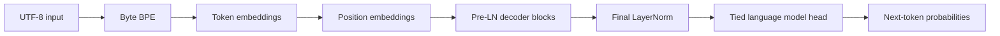

# Transformer From Scratch

A GPT-style decoder-only Transformer, byte-level BPE tokenizer and experiment pipeline implemented from scratch in PyTorch, with CPU-first reproducibility and a deliberately separate GPT-2 reference-parity test.


## Demo

The demo trains the configured **tiny** model on a synthetic text corpus, then prints a generated continuation. This is a correctness smoke test, not a pretrained language model. Sample output is dependent on seed and hardware; we do not present a hand-written output transcript as a real model result.

## Key results

| Experiment | Status |
| --- | --- |
| Byte-level BPE synthetic CPU throughput | [Measured, 3 corpora](docs/RESULTS.md) |
| Synthetic CPU model train/validation loss | [One-step measured evidence](docs/RESULTS.md) |
| Offline small randomly initialized HF GPT-2 logit parity | **Passed**, max absolute error 5.96×10⁻⁸ (see docs/RESULTS.md) |
| GPT-2 (124M) pretrained reference-logit match | **Not measured**, user-provided licensed weights required |
| RoPE / naive-vs-fused / cache equivalence | Covered in the CPU test suite |
| KV-cache speedup | Measured synthetic CPU smoke: 1.32–1.60× at contexts 8/16/32, two repeats (see docs/RESULTS.md and raw JSON) |
| Scaling and ablations | Measured 2-step scaling smoke (two seeds); ablation outcomes remain unmeasured; see docs/RESULTS.md |

## Why this exists

The project is an exercise in correctness and reproducibility, not a tutorial clone or an attempt to claim state-of-the-art language modeling. It includes ranked BPE merges, explicit causal masking, pre-LN/GELU GPT blocks, opt-in RoPE/SwiGLU/post-LN ablations, AdamW, deterministic checkpoint resume, and cached autoregressive decoding.

## Architecture



Inside each block: **LN -> packed QKV -> H attention heads -> causal mask -> attention projection -> residual; LN -> GELU 4x MLP -> residual.** Inputs are (B,T); embeddings (B,T,C); heads (B,H,T,D), where D=C/H. Incremental generation stores (K,V) per block.

## Quickstart

Requires Python 3.11 or 3.12. A CPU-only PyTorch wheel avoids installing large CUDA distributions:

```bash
python -m venv .venv
# Activate the venv using the conventions for your OS.
python -m pip install "torch==2.5.1+cpu" --index-url https://download.pytorch.org/whl/cpu
python -m pip install -e ".[dev,model]"
python scripts/tasks.py lint
python scripts/tasks.py typecheck
python scripts/tasks.py test-fast
python scripts/demo.py --profile tiny --steps 8
```

For a longer smoke train, run `python scripts/tasks.py demo` or `make demo` on Linux/macOS (Windows: Python task runner). **CPU runtime depends on hardware; not guaranteed until measured on a clean runner.**

## Usage examples

```bash
python -m tfs config --profile tiny
python -m tfs config --profile small
python bench/tokenizer.py --output results/tokenizer-smoke.json
python bench/kv_cache.py --output results/kv-cache.json
python eval/study.py --study scaling --steps 12 --output results/scaling.json
python eval/study.py --study ablations --steps 12 --output results/ablations.json
python results/study_render.py results/ablations.json
```

GPU-sized model profiles can be run on Colab/Kaggle with the same configuration files, but distributed training is unsupported. Large third-party pretrained weights must be obtained separately and only if their license and size are permitted.

## Configuration

Named YAML profiles: tiny (CPU; 1.27M predicted parameters), small (GPU; ~17.4M), and GPT-2 geometry (124,439,808). `.env.example` documents environment settings. Model size is measured by actual tensor count in GPT.count_parameters() and compared with the predicted formula in tests.

## How to reproduce the benchmarks

Tokenizer: `python bench/tokenizer.py --output results/tokenizer-smoke.json`, then `python results/render.py results/tokenizer-smoke.json`.

Studies: `python eval/study.py --study scaling --output results/scaling.json`, then `python results/study_render.py results/scaling.json`. Every saved JSON includes hardware, library version, config, seed and git SHA. No manually copied paper results appear as our own performance.

## Design decisions

[Decision log](docs/DESIGN.md), [attention design](docs/ATTENTION.md), [data pipeline](docs/DATA_PIPELINE.md), [reference citations](docs/REFERENCES.md), [failure diary](docs/WHAT_I_GOT_WRONG.md).

## Limitations

The full GPT-2 124M pretrained-weight logit parity claim remains unverified because the required model weight artifact exceeds the no-download-without-approval policy. Optional HF comparison with a small randomly initialized reference validates mapping mechanics but does **not** prove equivalence to the released 124M weights. No genuine TinyShakespeare/TinyStories benchmark, independent multi-dataset generalization study, production hardening, safety evaluation, or large-scale training is claimed. See [limitations](docs/LIMITATIONS.md).

## Roadmap

M0–M1: scaffolding and tokenizer. M2–M3: attention/GPT and reference mapping. M4–M6: data, training/resume, generation and KV cache. M7: synthetic small-scale studies and failure diary. M8: docs, reproducibility, CPU demo. v0.1 release hardening packages YAML configs and adds offline HF reference testing. Future work: licensed real-data benchmarks, pretrained 124M parity and hardware/GPU optimization.


## Release v0.1.0

[Release notes](docs/RELEASE_NOTES.md). Source and CPU-first smoke tests are the released artifact; **no trained model weights** are shipped. The release is not evidence of a production pretrained language model.

## License

MIT for original code. External dependencies and pretrained data are separately licensed; consult DATA.md and MODEL_CARD.md. This project is educational, not a production safety-certified model.

## Acknowledgements and citations

[References and what was taken from them](docs/REFERENCES.md). External model implementations are used only as test references.
